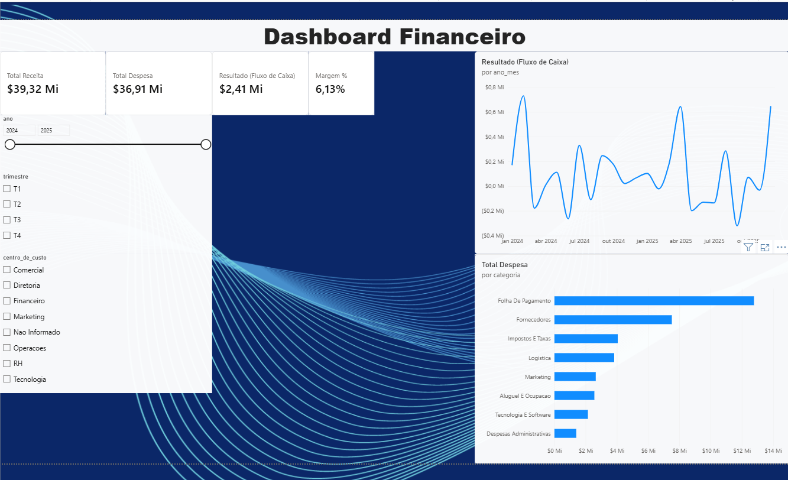

# Dashboard Financeiro em Power BI

Dashboard de acompanhamento financeiro construído do zero: uma base de transações simulada (com inconsistências propositais, como em dados reais), modelada em **esquema estrela** e analisada com **medidas DAX** no Power BI.

> Projeto de estudo com **dados fictícios**. O objetivo é praticar modelagem, DAX e Power Query, não representar uma empresa real.

## O que o dashboard mostra

- **Indicadores principais:** Total de Receita, Total de Despesa, Resultado (fluxo de caixa) e Margem %.
- **Resultado mês a mês** ao longo de 2024 e 2025, para enxergar meses de déficit e de superávit.
- **Despesa por categoria** (folha de pagamento, fornecedores, impostos, logística, marketing etc.).
- **Filtros** por ano, trimestre e centro de custo, que recalculam todos os visuais.

No recorte completo (2024–2025), a base fecha com R$ 39,32 mi de receita, R$ 36,91 mi de despesa, R$ 2,41 mi de resultado e margem de 6,13%. A folha de pagamento é, de longe, a maior categoria de despesa.

## Modelo de dados

Esquema estrela com uma tabela fato e três dimensões:

| Tabela | Papel |
|---|---|
| `Fato_Transacoes` | Cada lançamento financeiro (receita ou despesa), com data, categoria, centro de custo e valor |
| `Dim_Calendario` | Datas com ano, trimestre e ano/mês, usada na linha do tempo e nos filtros |
| `Dim_Categoria` | Categorias de receita e despesa |
| `Dim_CentroCusto` | Áreas da empresa (Comercial, Financeiro, Marketing, RH, Tecnologia etc.), incluindo "Não informado" para lançamentos sem centro de custo |
| `Resumo_Mensal` | Tabela auxiliar com o consolidado por mês |
| `medidas` | Tabela que agrupa as medidas DAX |

**Medidas DAX:** `Total Receita`, `Total Despesa`, `Resultado (Fluxo de Caixa)` e `Margem %`.

## Um problema real que apareceu no caminho

Depois da importação, os valores apareciam **inflados em cerca de 50 vezes**. A causa estava na configuração de idioma (localidade) usada na importação: os números eram convertidos no formato errado. A correção foi feita no Power Query, ajustando a conversão para a localidade certa.

Foi a parte mais útil do projeto: um erro silencioso, que não quebra nada, só deixa todos os números errados.

## Como abrir

1. Baixe o arquivo [`dashboard_financeiro.pbix`](dashboard_financeiro.pbix).
2. Abra no **Power BI Desktop** (gratuito, Windows).
3. Os dados já estão embutidos no arquivo, então não é preciso configurar nenhuma fonte.

## Ferramentas

Python (geração e tratamento da base simulada) · Power BI · Power Query · DAX

---

Autoria: **Gustavo Pontarollo** · Projeto de estudo em Análise de Dados
